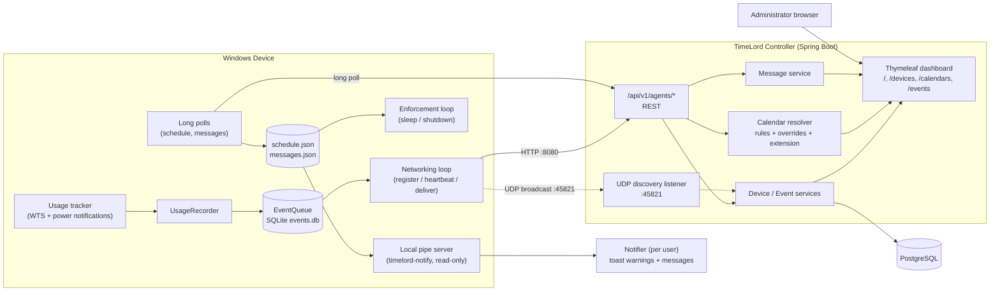
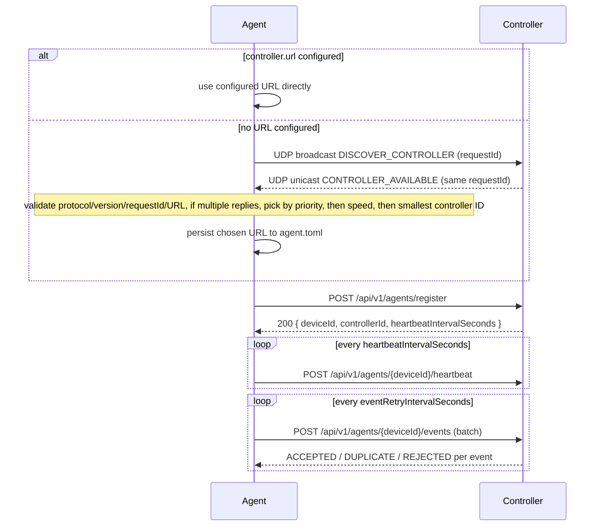

# TimeLord Architecture

> **This is a developer preview, not a product.** It exists to prove the
> shape of the system on a single trusted local network. It has not been
> hardened, load-tested, or run unattended for long periods, there are no
> stability guarantees between versions, and it is not meant for production
> use. See [Before you deploy this](#before-you-deploy-this) below.

> **It monitors, and it enforces calendars.** Beyond reporting what each
> device is doing, a device assigned a [calendar](scheduling.md) is put to
> sleep or shut down at its off times, with on-screen warnings from a
> [per-user notifier](notifier.md) and admin messages. There is still no
> session-limit enforcement, mandatory-break logic, connectivity rules, or
> immediate remote power commands. See [What's implemented](#whats-implemented)
> below.

> **It is also deliberately unsecured.** Plain HTTP, no authentication, no
> request signing, no access control — including on the admin API that
> manages calendars, sends messages and deletes devices. It exists to prove
> the shape of the system on a trusted local network, ahead of a later
> security phase. See [Security boundary](#security-boundary) below before
> running this anywhere else.

## Before you deploy this

- **Developer preview.** Expect rough edges, breaking config/schema changes
  between versions, and no migration tooling. Test on a couple of
  non-critical machines before trusting it with anything that matters.
- **Every agent must be able to reach the controller directly, on the same
  network(s).** All traffic — registration, heartbeats, event delivery, and
  discovery replies — is unicast HTTP (broadcast UDP only for the initial
  discovery request). There's no NAT traversal, no relay, and no
  cloud/VPN-aware routing: if an agent's machine can't open a TCP connection
  straight to `TIMELORD_PUBLIC_URL`, it can't be managed at all. See
  [Known limitations](#known-limitations) for the additional constraint this
  puts on UDP discovery specifically (same broadcast domain, not just same
  routed network).
- **The agent puts devices to sleep on its own schedule.** Two behaviours
  apply to a device that has **no calendar** assigned, and neither can be
  configured or disabled from the controller:
    - an unconditional sleep between **02:00 and 06:00 local time**, checked
      every 5 minutes (a stopgap hard-wired into the agent); and
    - if the agent can't reach the controller *at all* (registration,
      heartbeats, and event delivery all failing), a local safety schedule —
      by default **01:00 to 08:30** — that sleeps the device every 5 minutes
      while still disconnected (`SetSuspendState`: sleep, never hibernate).

  Changing the window, or turning the fallback off, means hand-editing that
  device's local `agent.toml` and restarting the service. Both are replaced
  by the calendar once a device has one (the agent caches it, so this holds
  while the controller is down too). See [Agent](agent.md#overnight-sleep-and-offline-fallback).
- **A calendar sleeps or shuts the device down.** At its off times a device
  with a [calendar](scheduling.md) is suspended or powered off (`shutdown.exe
  /s /t 30`, a 30-second warning). Test on a spare machine first; the
  agent-side actions are covered by unit tests and compile checks only.

## Summary

TimeLord has four moving pieces:

- **TimeLord Agent** (Rust) — runs on each Windows device as a service. Tracks
  when the device is actually in use (not just powered on — see
  `agent/README.md`), who's logged in, and every network adapter (name/MAC/
  address). Finds a controller (explicit URL or UDP discovery), registers, and
  reports usage/lifecycle events and heartbeats. Caches its calendar schedule
  and enforces it (sleep or shutdown), and serves a local pipe to the notifier.
- **TimeLord Notifier** (Rust) — a small program that runs in each logged-on
  user's session, polls the agent over a local pipe, and shows toast warnings
  before a sleep/shutdown plus administrator messages.
- **TimeLord Controller** (Java 21 / Spring Boot) — the single source of truth.
  Accepts registration/heartbeats/events over HTTP, listens for UDP discovery
  requests, persists everything to PostgreSQL, computes each device's status,
  resolves calendars into off windows, queues messages, and serves both the
  REST API and a server-rendered (Thymeleaf) admin dashboard.
- **PostgreSQL** — durable storage for devices, events, heartbeats, calendars,
  and messages.

The agent never loses an event to a controller outage: every event is written
to a local SQLite queue *before* any delivery attempt, and only removed once
the controller acknowledges it (including an acknowledged *duplicate*, which
counts as delivered). Time-sensitive events (agent shutdown, reconnecting
after being offline) flush immediately rather than waiting for the next
scheduled retry.

## What's implemented

- **Device registration, heartbeats, event ingestion** over the HTTP
  API, with idempotent event submission (see
  [Event delivery and idempotency](#event-delivery-and-idempotency)).
- **Two independent statuses per device**, shown on the dashboard:
    - **Online / Offline** — is the agent reachable (heartbeat recency)?
    - **Active** — is a user actually logged in right now (`Device.isActive()`
      — online *and* a current user reported over heartbeat)?
- **Login sessions** — a per-device history of login → logout spans
  (`DeviceSessionService`), reconstructed at read time from `USER_LOGON` /
  `USER_LOGOFF` / `AGENT_STOPPING` / `SYSTEM_SUSPEND` / `HEARTBEAT_SENT`
  events rather than stored in a separate table. A device that's merely
  online with nobody logged in — including right after the agent starts —
  has no session at all; only an actual logon starts one, and logoff, agent
  shutdown, suspend, or the agent going silent for too long ends it.
- **Activity history** — `ACTIVE` and `INACTIVE` are persisted separately from
  session events. A real logon can therefore produce `USER_LOGON` followed by
  `ACTIVE`; startup reconciliation does not produce a synthetic logon.
- **Network interface inventory** — every adapter the OS reports (not just
  ones with a routable address), with name, MAC, and address(es), shown on
  the device detail page.
- **Calendars** — named weekly on-windows (any number per day) with dated
  overrides that only add time, assigned to devices. The controller resolves a calendar into concrete off windows
  (applying any extension) and sends them to the agent with a revision; the
  agent caches them in `schedule.json` and sleeps or shuts the device down
  inside a window, even offline. See [Calendars](scheduling.md).
- **Extensions** — a per-device "allow longer" grant (+15/30/60 min) that
  delays the next off window without touching the calendar.
- **Push-style change delivery** — the agent long-polls the controller for
  schedule changes and messages, so an extension or a message takes effect in
  moments, not at the next heartbeat.
- **Messages** — free-text messages from the dashboard to one or all devices,
  stored with a per-device cursor and delivered when the device is (back)
  online, until they expire.
- **Notifier** — a per-user program that polls the agent over a local named
  pipe and shows toast warnings before a sleep/shutdown and any messages. See
  [Notifier](notifier.md).
- **Admin dashboard** — device list with live status, per-device detail
  (including calendar, extension and messages), calendar management, a
  searchable/filterable event log, and device deletion (removes the device's
  events, heartbeats and messages; a still-running agent simply registers
  again).

Not implemented: session-limit enforcement, mandatory breaks, connectivity
requirements, immediate remote power commands (the only remote action is
granting more time), a countdown window or tray icon in the notifier, or any
policy engine beyond calendars — despite what the root README's tagline
aspires to.

## Component diagram

## Discovery sequence

Active discovery (the primary mechanism) vs. the explicit-URL path both feed
into the same registration flow:

UDP broadcast only reaches devices in the same broadcast domain, and Docker's
bridge network typically doesn't forward broadcast traffic to a published
UDP port at all — see [Known limitations](#known-limitations). The explicit
`controller.url` path always works and is what `.env.example` sets up by
default.

## Schedule and message delivery

Calendars and messages reach an agent two ways, and the second is what makes
changes take effect quickly:

- **Heartbeat responses** (and registration) carry the device's current
  schedule, resolved to concrete off windows for the next 7 days plus a
  `revision` that changes whenever they do.
- **Long polls.** The agent keeps `GET /api/v1/agents/{id}/schedule?revision=…`
  and `GET /api/v1/agents/{id}/messages?after=<seq>` open for up to ~30
  seconds each (own connections, so they never block heartbeats). The
  controller answers the moment the revision differs or a message is queued
  for that device — an extension, assignment, calendar edit or new message —
  and otherwise returns after the timeout so the agent asks again.

The agent caches both (`schedule.json`, `messages.json`) and keeps enforcing
from the cache while the controller is unreachable. Because that cache can be
stale after the device has been off or asleep, the agent re-confirms it with
the controller on startup and after a sleep before enforcing it (falling back
to the cache after 90 seconds without an answer). The notifier then reads
that cache through the agent's local pipe; see [Notifier](notifier.md#how-it-works).

## Event delivery and idempotency

- Every event gets a client-generated `eventId` (UUID). The controller uses it
  as the primary key of `device_event`, so retransmitting the same event is
  safe: the second submission is reported as `DUPLICATE`, not inserted again.
- The agent's local queue (`events.db`) treats `DUPLICATE` the same as
  `ACCEPTED` — both remove the event from the local queue.
- A failed submission schedules a retry with bounded backoff (10s, 30s, 1m,
  5m, 15m, 30m, holding at 30m), and an event that fails
  [`MAX_ATTEMPTS`](https://github.com/johnjoeallen/timelord/blob/main/agent/src/queue.rs) times is discarded rather than
  retried forever.

## Security boundary

This phase intentionally has:

- No TLS (plain `http://`)
- No authentication of agents or administrators
- No request signing or replay protection
- No access control on any endpoint — including the admin endpoints that
  create/edit calendars, assign them, grant extensions, send messages and
  delete devices. Anyone who can reach the controller can do all of that.

The one local control is the agent's notifier pipe: its access list lets
SYSTEM and Administrators do anything and lets ordinary users read and write
data only (no creating pipe instances), and it refuses remote clients. The
pipe is read-only — a user can ask what is pending but cannot change anything
through it.

**Only run this on an isolated or trusted local network.** The code is
structured so a later phase can add HTTPS, controller-key pinning, Ed25519
agent identity, signed events, and role-based admin access without rewriting
the event model:

- Controller: `AgentRequestAuthenticator` (`common/AgentRequestAuthenticator.java`)
  — ships only `NoOpAgentRequestAuthenticator`.
- Agent: `RequestSigner` trait (`controller_client.rs`) — ships only
  `NoOpRequestSigner`.

## Known limitations

- **Docker + UDP broadcast**: a Windows agent on the LAN broadcasting to
  `255.255.255.255:45821` generally will not reach a controller published
  from inside Docker's default bridge network — Docker's NAT forwards
  packets addressed to the host's specific IP, not to the broadcast address.
  Use the explicit `controller.url` (Mode A) for anything beyond same-host
  experimentation, or run the controller directly on the host for discovery
  testing. `TIMELORD_PUBLIC_URL` must be a LAN-reachable address, never the
  in-Docker hostname `controller`.
- **`TIMELORD_PUBLIC_URL`** is what gets handed to agents during discovery and
  registration responses; it must be reachable from agent devices, which
  `.env.example` calls out.
- **OS version detection** is a placeholder (`agent_version`/architecture are
  real; `operatingSystemVersion` is not populated yet) — see `agent.rs::os_info`.
- **No persisted `device_session` table yet** — `EventItem.sessionId` is
  always `null`; the OS-level Windows session ID is carried in
  `data.windowsSessionId` instead. The dashboard's "User sessions" list (see
  [What's implemented](#whats-implemented)) is reconstructed at read time
  from the event log by `DeviceSessionService`, not backed by a session
  table — that's still a later phase.
- **Login sessions are single-user-at-a-time per device** — the agent caches
  one username per Windows session ID, but the controller's session/active
  model doesn't distinguish concurrent logons (fast user switching, RDP).
- **No idle-time detection** — a Session-0 service can't call
  `GetLastInputInfo` for the interactive desktop; heartbeats currently send
  `idleSeconds: null`. The per-user notifier is the natural home for this
  but doesn't report idle time yet. See `agent/README.md`.
- **Calendars wake nothing.** "On" means allowed to be on; a sleeping device
  stays asleep until someone wakes it (there is no Wake-on-LAN).
- **Enforcement is only unit-tested.** The agent's sleep/shutdown and the
  notifier's toasts compile for Windows and their logic is tested, but they
  have not been run end to end on real machines.
- **Message "delivered" is not "seen"** — the controller records when it
  handed a message to the agent, not whether the user saw it.
- **The agent's message cursor is a database sequence.** If the controller
  database is reset, an agent holding a higher cursor will miss new messages
  until its `messages.json` is deleted.
