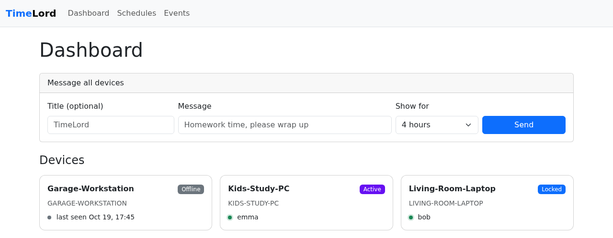
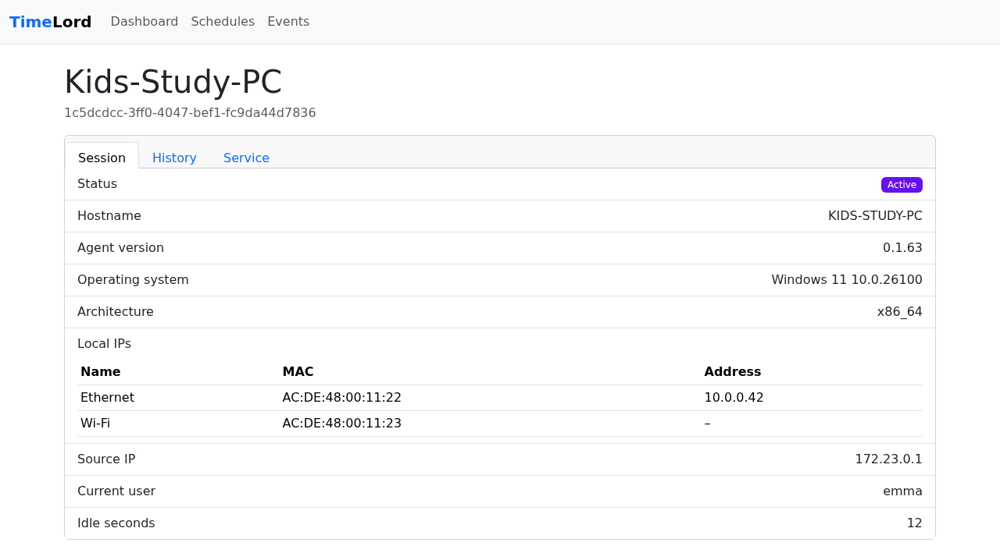
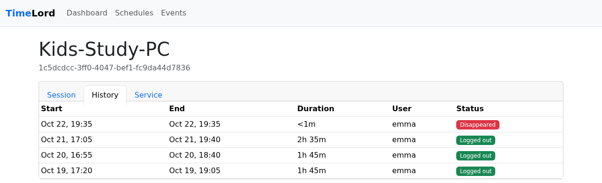
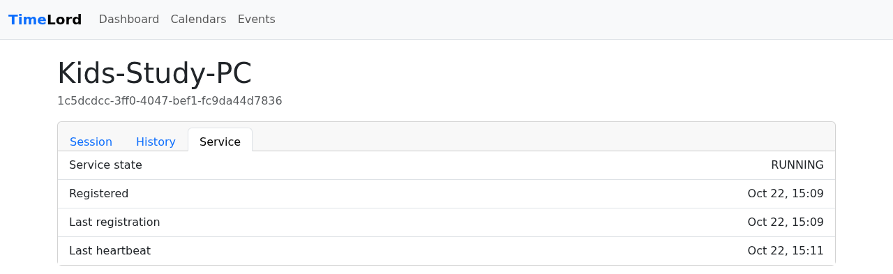
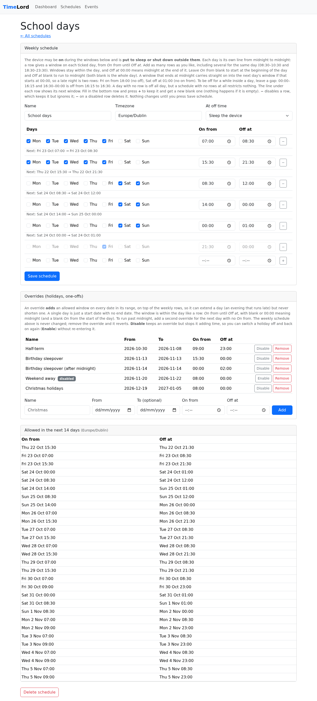
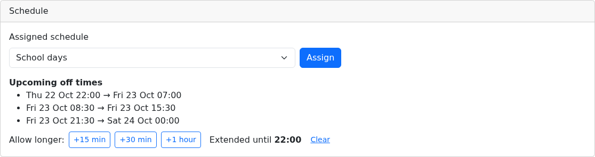

# TimeLord

TimeLord tracks how Windows devices on your network are actually being used — who's logged in,
for how long, and whether the machine is even reachable — shows it on a live dashboard, and can
put devices to sleep or shut them down on a schedule you control, warning the person at the
keyboard first.

!!! danger "Developer preview — not for production use"
    This is a working proof of the system's shape, not a hardened product. Expect rough edges and
    breaking changes between versions. Things worth knowing before you point it at real devices —
    details in [Before you deploy this](architecture.md#before-you-deploy-this):

    - **It acts on devices.** A device with a [schedule](scheduling.md) is put to sleep or shut
      down at its off times. Session limits, forced breaks and connectivity rules are **not**
      implemented — the project's tagline still describes the eventual product.
    - **Devices without a schedule still get put to sleep overnight.** A hard-wired sleep runs
      02:00–06:00 local time, and an agent that can't reach the controller at all also sleeps the
      device 01:00–08:30 — neither configurable from the controller.
    - **Every agent must reach the controller directly, on the same network(s).** Everything is
      unicast HTTP — no NAT traversal, relay, or cloud/VPN routing.

    It also runs over plain, unauthenticated HTTP — and that includes the admin API, so anyone
    who can reach the controller can send messages, grant extra time and delete devices. See
    [Security boundary](architecture.md#security-boundary) before running it anywhere but a
    trusted local network.

## What it actually does today

- **Windows agent** (Rust service) watches Windows session/power notifications — logon, lock,
  unlock, logoff, console/RDP connect and disconnect, suspend, resume — and the currently
  logged-in user (including one already logged in when the service starts), and reports them to
  a controller. Every event is queued to local disk before delivery, so a controller outage never
  loses data; queued events retry with backoff and flush immediately on reconnect or shutdown.
- **Controller** (Java / Spring Boot / PostgreSQL) accepts registration, heartbeats, and events
  over HTTP, and shows each device as one of three states:
    - **Offline** — no events received within the timeout window.
    - **Inactive** — online (agent reachable, recent heartbeats), but nobody's logged in.
    - **Active** — online and a user is actually logged in right now.
- **Login sessions** — a per-device history of login → logout spans, derived from the event log,
  distinct from "the agent was running." Starting the service with nobody logged in shows the
  machine online but produces no session at all.
- **Schedules** — named weekly schedules of **on-windows**, several per day if you like (e.g. on
  07:00–08:30 and 15:30–21:30 on school days), with dated **overrides** that add time for holidays and
  never modify the base schedule. The device is slept or shut down whenever it is outside every window.
  Assign a schedule to each device; the agent keeps enforcing from a local cache even if the controller
  is down. See [Schedules](scheduling.md).
- **Allow longer** — one click (+15 / +30 / +60 minutes) lets a device stay on past its off time;
  the agent hears about it within moments via a long poll.
- **Notifier and messages** — a small per-user program shows Windows toast warnings before a
  sleep or shutdown, and messages you send from the dashboard to one or all devices. See
  [Notifier](notifier.md).
- **Dashboard** — a server-rendered admin UI: device list with live status, per-device detail
  (network interfaces, current user, login history, schedule, messages), schedule management, a
  searchable event log, and device deletion.

## Screenshots

<figure markdown>
  
  <figcaption>The dashboard shows exactly one status badge per device — here Offline, Active
  (online with someone logged in) and Locked — and a form to send a message to every device.</figcaption>
</figure>

<figure markdown>
  
  <figcaption>Device detail — Session tab: live status, every network adapter (name/MAC/address),
  and who's currently logged in.</figcaption>
</figure>

<figure markdown>
  
  <figcaption>Device detail — History tab: every login session for this device, and how each one
  ended (logged out, disappeared, and so on).</figcaption>
</figure>

<figure markdown>
  
  <figcaption>Device detail — Service tab: the agent service's own state — registration and
  heartbeat timestamps, independent of whether anyone's logged in.</figcaption>
</figure>

<figure markdown>
  
  <figcaption>A schedule: weekly rows (several windows on the same day), dated overrides (half-term, a
  sleepover, the Christmas holidays) that only ever add time, and the on-windows it resolves to over
  the next 14 days.</figcaption>
</figure>

<figure markdown>
  
  <figcaption>On a device: the assigned schedule, its upcoming off times, and one-click +15 / +30 /
  +60 minute extensions (here, 30 minutes already granted).</figcaption>
</figure>

## Get started

TimeLord runs as two containers — `postgres` + `controller` — via `docker compose`:

```console
$ cp .env.example .env        # edit TIMELORD_PUBLIC_URL to your LAN IP
$ docker compose up --build   # postgres + controller on :9099, discovery UDP on :45821
```

Open `http://localhost:9099` for the dashboard, or:

```console
$ curl http://localhost:9099/api/v1/system/info
```

### Try the agent against it (from a dev machine, any OS)

```console
$ cd agent
$ TIMELORD_CONTROLLER_URL=http://localhost:9099 cargo run -- run
timelord-agent> logon
timelord-agent> lock
timelord-agent> quit
```

This registers a device, sends an `AGENT_STARTED`/`USER_LOGON`/... event trail, and a heartbeat —
all visible on the dashboard within a few seconds. See [Agent](agent.md) for what
`logon`/`lock`/... actually mean (the dev backend's interactive REPL stands in for real Windows
session notifications when not running on Windows).

## Components

| Component         | Path          | Language                    | What it does |
|--------------------|---------------|------------------------------|----------------|
| TimeLord Agent     | `agent/`      | Rust (Windows service)       | Tracks usage, reports it, enforces the schedule |
| TimeLord Notifier  | `notifier/`   | Rust (per-user program)      | Toast warnings and messages for the logged-on user |
| Shared IPC types   | `ipc/`        | Rust (library)               | Agent ↔ notifier pipe message types |
| TimeLord Controller| `controller/`| Java 21 / Spring Boot        | Registration, heartbeats, events, schedules, messages, dashboard |
| TimeLord Protocol  | `protocol/`  | JSON Schema                  | Not yet populated |

## Further reading

- [Architecture](architecture.md) — component diagram, discovery/registration sequence, event
  delivery and idempotency, security boundary, known limitations
- [Agent](agent.md) — agent internals, CLI, configuration, local dev workflow
- [Controller](controller.md) — controller internals, API, running tests
- [Schedules](scheduling.md) — weekly rules, holiday overrides, extending a device, how the
  agent enforces and caches the schedule
- [Notifier](notifier.md) — toast warnings, sending messages, the local pipe
