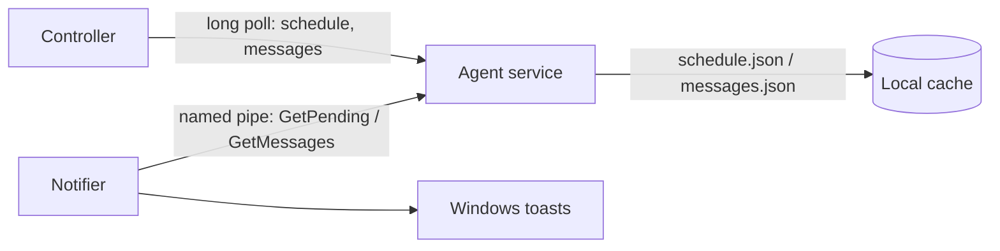

# Notifier and messages

The **notifier** is a small per-user program that gives the person at the keyboard notice of
what the device is about to do, and shows messages sent by an administrator. It runs in each
logged-on user's own session; the [agent service](agent.md) still does all enforcement, so the
schedule applies whether or not the notifier is running. The notifier only provides warning.

!!! note "Developer preview"
    The notifier is new, has had unit tests and Windows compile checks but no field testing, and
    still lacks a last-minute countdown window and a tray icon (see [Limitations](#limitations)).

## What the user sees

**Warnings before sleep or shutdown.** As an off time approaches (from a
[calendar](scheduling.md)), a Windows toast appears at 15 minutes, 5 minutes, 1 minute and 30
seconds, e.g. *"This computer will go to sleep in 5 minutes — Scheduled: go to sleep at 22:30.
Save your work."*

- Each tighter warning **replaces** the looser one in place rather than stacking.
- The 1-minute and 30-second warnings use the Windows *reminder* scenario, so they stay on
  screen until dismissed.
- If the notifier starts with 3 minutes left it shows the 5-minute warning, not also the 15.
- If the action is cancelled or moved — for example you press **+30 min** on the device page —
  the toast is removed, and a new warning follows for the new time.

**Messages.** Anything sent from the dashboard appears as a toast with the title you gave (or
"TimeLord"). Each message is shown **once**; the notifier remembers which it has shown, per user,
so a restart or a later logon does not repeat them.

## Sending a message

From a device's page use **Send a message**, or from the dashboard use **Message all devices**.

| Field | Notes |
|-------|-------|
| Title | Optional, up to 100 characters |
| Message | Required, up to 500 characters |
| Show for | How long the message stays deliverable: 15 minutes, 1 hour, 4 hours (default) or 24 hours |

A message to an offline device is held and delivered when the device reconnects, as long as it has
not expired. The device page lists the last 10 messages as **waiting**, **delivered** or
**expired**. *Delivered* means the controller handed it to the agent; it does not mean the user
has seen it.

=== "One device"

    ```console
    $ curl -X POST http://localhost:9099/api/v1/devices/$DEVICE_ID/messages \
        -H 'Content-Type: application/json' \
        -d '{"title": "Dinner", "body": "Ready in 10 minutes", "expiresInMinutes": 60}'
    ```

=== "Every device"

    ```console
    $ curl -X POST http://localhost:9099/api/v1/messages \
        -H 'Content-Type: application/json' \
        -d '{"body": "Lights out at 22:30 tonight", "expiresInMinutes": 240}'
    ```

`GET /api/v1/devices/{id}/messages` lists a device's recent messages. `expiresInMinutes` may be
1 to 10080 (7 days). Like the rest of the admin API these endpoints are unauthenticated in this
preview — see the [security boundary](architecture.md#security-boundary).

## How it works



- The agent long-polls the controller for **messages** with a cursor (`seq`), the same push-style
  mechanism it uses for schedule changes, and caches them in `messages.json` next to
  `schedule.json`. A message is never fetched twice and survives restarts.
- The notifier asks the agent over a local named pipe, `\\.\pipe\timelord-notify`, using one JSON
  line per request and response. Two requests exist: `GetPending` (power actions starting in the
  next 30 minutes) and `GetMessages` (unexpired messages). The service is a passive, read-only
  responder and recomputes each answer from its current cache, so cancellations and extensions
  show up on the next poll. All timing and toast logic lives in the notifier.
- The notifier polls every 10 seconds, and every 2 seconds in the last 90 seconds before an
  action. It judges remaining time against the service's clock, so a wrong clock on the user's
  account does not shift the warnings.
- The pipe's access control lets SYSTEM and Administrators do anything and lets ordinary users
  read and write *data* only. In particular, users cannot create another instance of the pipe, so
  they cannot impersonate the service to other users.
- Toasts need an app identity; the notifier registers `TimeLord.Notifier` under
  `HKCU\Software\Classes\AppUserModelId` for the current user (no administrator rights needed).

## Installing

`install.ps1` in the release zip installs the notifier and a **TimeLord Notifier** scheduled task
that starts it at every user's logon (as that user, with limited rights, restarting on failure,
one instance per session). Pass `-SkipNotifier` to install only the service. See
[Running on Windows](agent.md#running-on-windows) and `deployment/windows/README.md`.

Per-user files live under `%LOCALAPPDATA%\TimeLord`:

```text
notifier.log             Problems (the notifier has no console); rotated at 256 KiB
notifier-shown.json      Ids of messages already shown to this user
```

## Limitations

- No **countdown window** for the last minute and no **tray icon** yet; toasts are the only
  display, and Windows Focus Assist can suppress ordinary toasts (reminder-scenario ones fare
  better).
- No postponing from the notifier — the only way to grant more time is the controller's **+15 /
  +30 / +60 min** buttons.
- "Delivered" is not "seen": the notifier does not report back to the service or controller.
- Windows only; there is nothing to talk to on other systems.
