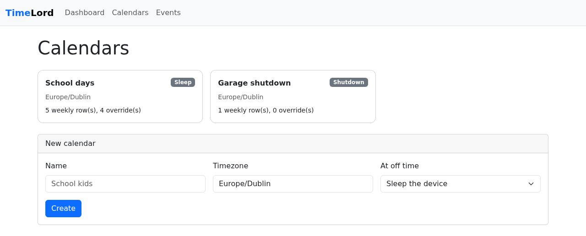

# Schedules

A **schedule** tells a device when it may be **on**. You create named schedules in the dashboard,
assign each device to one, and the agent puts the device to sleep (or shuts it down) whenever the
schedule says it should be off — that is, outside every on-window. Nothing wakes a sleeping device:
"on" only means *allowed to be on*.

<figure markdown>
  
  <figcaption>The Schedules page: each schedule's action, timezone and how many weekly rows and overrides it has.</figcaption>
</figure>

!!! note "Developer preview"
    Scheduling is new. The agent-side sleep and shutdown have not been exercised on real hardware
    beyond compile checks and unit tests — try it on a spare machine first (see
    [Trying it safely](#trying-it-safely)).

<figure markdown>
  
  <figcaption>The schedule editor: weekly rows (several on the same day), overrides that add time, and the resolved on-windows for the next 14 days.</figcaption>
</figure>

## How a schedule works

A schedule has a **name**, a **timezone**, and an **action** taken at off time:

| Action     | What the agent does |
|------------|---------------------|
| `SLEEP`    | Suspends the device (`SetSuspendState`, never hibernate) and keeps re-suspending it for as long as the schedule says off, if someone wakes it. |
| `SHUTDOWN` | Runs `shutdown.exe /s /t 30` — a 30-second on-screen warning, then power off. |

### Weekly rows (the base schedule)

Each day is its own line from midnight to midnight. A **row** has a set of **days**, an **On from**
time and an **Off at** time, and says: *on each of these days the device may be on from On from until
Off at*. You can add as many rows as you like, **including several for the same day**. All the
windows are combined; the device is on inside them and off everywhere else.

| Days | On from | Off at | Meaning |
|------|---------|--------|---------|
| Mon–Fri | 08:30 | 10:30 | On 08:30–10:30 ... |
| Mon–Fri | 18:30 | 23:30 | ... and again 18:30–23:30; off the rest of the day |
| Sat, Sun | *(blank)* | *(blank)* | The whole day |
| Thu | 00:00 | 16:15 | On from midnight until 16:15 ... |
| Thu | 16:30 | 00:00 | ... off 16:15–16:30, on again 16:30 until midnight |

Rules for the times:

- **Windows stay inside their day.** A window never runs past midnight; **Off at 00:00 means midnight
  at the end of the day**, so `18:30 → 00:00` is the evening and `00:00 → 00:00` is the whole day.
  Off at must otherwise be later than On from, and the dashboard and API refuse a row that isn't.
- **Blank means the edge of the day.** Leave **On from** blank to start at the beginning of the day
  (00:00) and **Off at** blank to run to midnight; both blank is the whole day.
- **The next day takes over.** A window that ends at midnight simply continues into the next day's
  window if that starts at 00:00 — there is no gap at midnight. So a late night is two rows:
  *Fri, on from 18:00, no off* and *Sat, no on from, off at 01:00* give one continuous window from
  Friday 18:00 to Saturday 01:00.
- **Off for a while inside a day** is a gap between two rows (the Thursday example above).
- **A day with no row is off all day** — but a schedule with **no rows at all** restricts nothing,
  so a newly created, still-empty schedule doesn't keep a device asleep.

Each row on the schedule page shows its next window (for example *Next: Thu 22 Oct 18:30 → Thu 22
Oct 23:30*), and the page lists the combined on-windows for the next 14 days, so you can check what a
schedule does before relying on it.

!!! note "Earlier versions"
    Earlier versions described a schedule as *off* times (one rule per day, an off and an on time,
    with an inferred "after midnight"). On upgrade the controller converts existing schedules to
    on-windows automatically: weekly rules become the equivalent rows exactly. Overrides are
    converted too, but they can no longer *narrow* a day (see below). A schedule whose old rules left
    no on-time at all ends up with no rows, which restricts nothing.

### Overrides (holidays and one-offs)

An **override** is a date range with an On from and an Off at time, written like a row (same blank
and midnight rules). It is **layered on after** the weekly rows are expanded: for every date in the
range it *adds* that window to the day, and everything is combined. So an override can **extend** a
day or **add** time on a day with no row, but it can **never narrow** one — an override inside an
existing window changes nothing. The weekly rows themselves are never edited; remove the override and
the day goes back. A single day is an override whose start and end date are the same (in the
dashboard, leave "To" blank). Overrides stack.

!!! example
    Weekdays normally have 07:00–08:30 and 15:30–21:30. *Half-term, 30 Oct – 8 Nov, on 09:00–23:00*
    adds a long window each of those days, so the device is on 07:00–08:30 and 09:00–23:00 (the
    window 15:30–21:30 is absorbed). *Birthday sleepover, 13 Nov, on from 15:30* extends that evening
    to midnight, and a second override for *14 Nov, off at 02:00* (no on from) carries it to 02:00.
    To let a holiday run late you add the early-hours piece as an override for the next date.

### Allowing a device longer

<figure markdown>
  
  <figcaption>The device page: schedule assignment, upcoming off times and the extension buttons.</figcaption>
</figure>

On a device's page, **+15 min / +30 min / +1 hour** grant a temporary **extension**:

- If the device is already inside an off window, it is allowed back on for that long from now.
- Otherwise the next off window starts that much later.
- Each request may grant 1–240 minutes; the page shows "Extended until HH:MM" with a **Clear**
  button.

An extension never edits the schedule. It is cleared if you assign the device a different
schedule.

## How the device enforces it

The controller resolves the schedule (rows, overrides and any extension) into **concrete off
windows** — the gaps between the on-windows, as absolute start and end times for the next 28 days — and
sends them to the agent with a **revision** that changes whenever they do. The agent therefore never
has to understand rows or overrides; it only asks whether the time now falls inside an off window.

- **Cached locally.** The latest schedule is saved as `schedule.json` next to `agent.toml`, so
  enforcement continues across restarts and while the controller is unreachable.
- **Startup and resume.** The cached schedule can be stale: the schedule may have been edited, or
  the device granted more time, while it was off or asleep. So the agent does **not** enforce the
  cache the moment it starts. It waits until the controller has confirmed the schedule (in the
  registration or heartbeat response, or a long poll). If the controller stays unreachable for
  90 seconds it enforces the cache anyway, so an offline device is still governed. The same
  re-confirmation happens after the agent resumes from a sleep it caused, and after any wake it
  notices (a wake-up much later than planned, such as a closed lid). The notifier is not told about
  upcoming actions from an unconfirmed cache either. In practice a device that boots inside a
  cached off window stays on for a few seconds while it checks in, then either goes back to sleep
  (nothing changed) or stays on (the schedule or an extension now says it may).
- **Changes arrive immediately.** Besides every heartbeat, the agent holds a long poll open to
  `GET /api/v1/agents/{id}/schedule?revision=…`. The controller answers the moment an extension,
  assignment or schedule edit changes the revision, so "+30 minutes" takes effect within moments,
  not at the next heartbeat. With no change the request simply returns after about 30 seconds and
  the agent asks again.
- **Enforcement loop.** The agent acts when the current time is inside an off window, and
  re-checks at the next window start, on any schedule change, and at least every 60 seconds — so a
  device woken mid-window is put back to sleep within about a minute. Each action is reported as
  `POWER_ACTION_REQUESTED` / `_COMPLETED` / `_FAILED` events.

### Devices without a schedule

A device with no schedule assigned keeps the older hard-wired behaviour, which is **not
configurable from the controller**:

- an unconditional sleep between **02:00 and 06:00** local time, checked every 5 minutes; and
- the [offline fallback](agent.md#overnight-sleep-and-offline-fallback) (sleep between 01:00 and 08:30 while the
  controller is unreachable).

Both stop applying as soon as the agent has a cached schedule.

## Admin API

All of these are unauthenticated in this preview — see the [security boundary](architecture.md#security-boundary).

| Method and path | Purpose |
|-----------------|---------|
| `GET /api/v1/calendars` · `GET /api/v1/calendars/{id}` | List / read schedules (with rows and overrides) |
| `POST /api/v1/calendars` | Create |
| `PUT /api/v1/calendars/{id}` | Replace name, timezone, action and the **whole set of weekly rows** (overrides untouched) |
| `DELETE /api/v1/calendars/{id}` | Delete; devices using it lose their schedule |
| `POST /api/v1/calendars/{id}/overrides` | Add an override |
| `DELETE /api/v1/calendars/{id}/overrides/{overrideId}` | Remove an override |
| `GET /api/v1/calendars/{id}/allowed?from=&days=` | Preview the resolved on-windows (what the dashboard's table shows) |
| `GET /api/v1/calendars/{id}/windows?from=&days=` | Preview the resolved off windows (what the agent is sent) |
| `PUT /api/v1/devices/{id}/calendar` | Assign (`{"calendarId": "<uuid>"}`) or clear (`{"calendarId": null}`) |
| `POST /api/v1/devices/{id}/extend` | Allow longer (`{"minutes": 30}`) |
| `GET /api/v1/agents/{id}/schedule` | Agent long poll for schedule changes (`204` = no schedule) |

=== "Create a schedule"

    The JSON field for a row is still called `rules`; `startTime` / `endTime` may be left out
    (start or end of the day), and `00:00` as an end means midnight.

    ```console
    $ curl -X POST http://localhost:9099/api/v1/calendars \
        -H 'Content-Type: application/json' -d '{
          "name": "School days",
          "timezone": "Europe/Dublin",
          "action": "SLEEP",
          "rules": [
            {"days": ["MONDAY","TUESDAY","WEDNESDAY","THURSDAY","FRIDAY"], "startTime": "07:00", "endTime": "08:30"},
            {"days": ["MONDAY","TUESDAY","WEDNESDAY","THURSDAY","FRIDAY"], "startTime": "15:30", "endTime": "21:30"},
            {"days": ["SATURDAY","SUNDAY"], "startTime": "08:30", "endTime": "12:00"},
            {"days": ["SATURDAY","SUNDAY"], "startTime": "14:00"},
            {"days": ["SATURDAY","SUNDAY"], "endTime": "01:00"}
          ]
        }'
    ```

=== "Add a holiday override"

    ```console
    $ curl -X POST http://localhost:9099/api/v1/calendars/$CALENDAR_ID/overrides \
        -H 'Content-Type: application/json' -d '{
          "name": "Christmas",
          "startDate": "2026-12-19",
          "endDate": "2027-01-05",
          "startTime": "08:00"
        }'
    ```

=== "Another 30 minutes"

    ```console
    $ curl -X POST http://localhost:9099/api/v1/devices/$DEVICE_ID/extend \
        -H 'Content-Type: application/json' -d '{"minutes": 30}'
    ```

Validation errors come back in the usual [error shape](controller.md#api), for example
`INVALID_TIMEZONE`, `INVALID_RULE` (no days, or an Off at that is not after On from — a window
can't run past midnight, add a row for the next day), `INVALID_OVERRIDE` (the same, or an end date
before the start date), `CALENDAR_NAME_TAKEN` (`409`), and `NO_CALENDAR` / `NO_OFF_WINDOW` (`409`) when
extending a device that has nothing to extend.

## Trying it safely

1. Create a schedule with a window that ends about 20 minutes from now (say, *on from* blank, *off
   at* 20 minutes ahead, for today's weekday) and the **Sleep** action, and assign it to a spare
   device. Remember the rest of that day, and every other day without a row, is then off.
2. Watch the device sleep at the end of the window; wake it and confirm it is put back to sleep.
3. Assign it again, press **+15 min** shortly before the window ends, and confirm it stays on.
4. Only then try **Shutdown**, again on a machine you can afford to power off.
